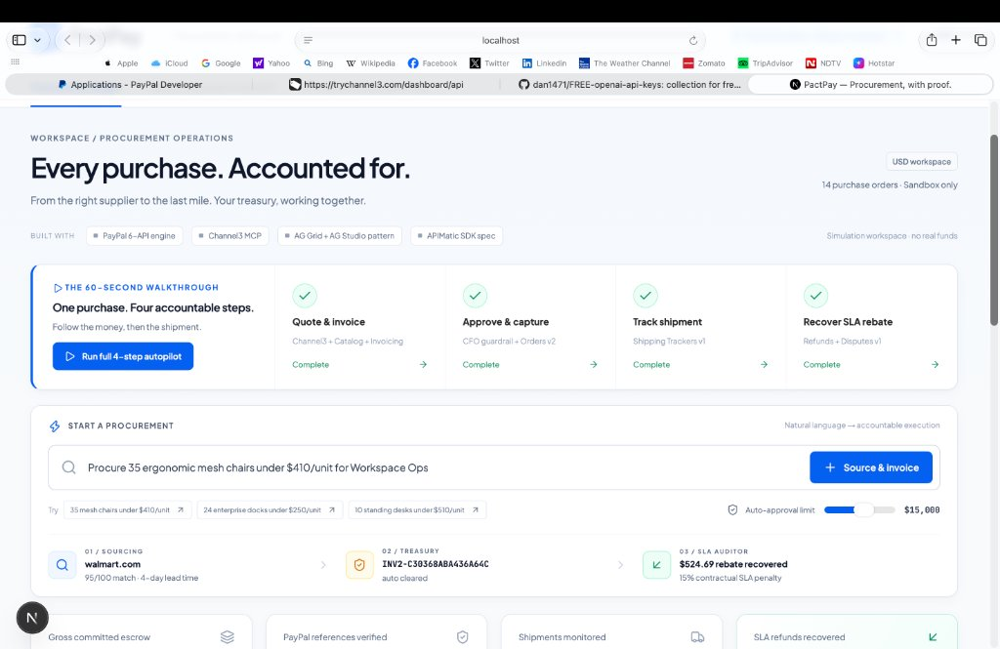
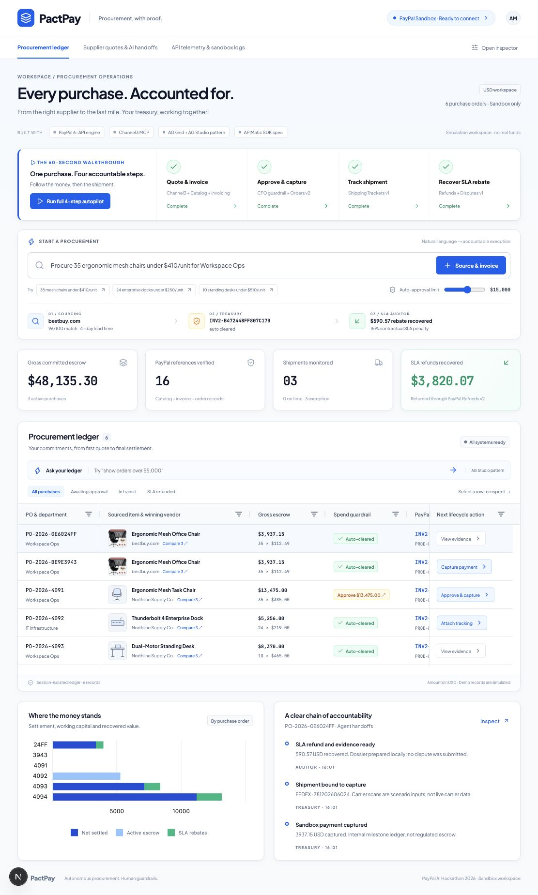
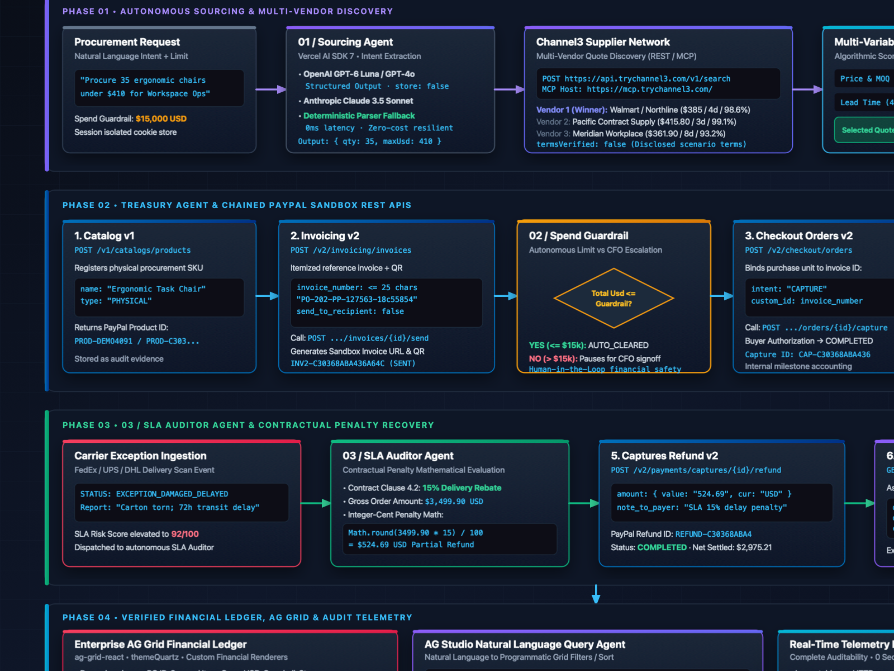

# PactPay

<div align="center">

### Autonomous B2B Sourcing, Milestone Payments & SLA Recovery on PayPal Sandbox

*An auditable multi-agent workspace built for the **PayPal AI Hackathon 2026**.*

**Live Hosted Demo:** [https://pactpayon.vercel.app](https://pactpayon.vercel.app)

[](https://pactpayon.vercel.app)
[](https://developer.paypal.com)
[](https://github.com/paypal/agent-toolkit)
[](https://nextjs.org)
[](https://www.typescriptlang.org/)
[](https://www.ag-grid.com)
[](https://trychannel3.com)
[](https://render.com)
[](scripts/lifecycle.test.ts)
[](LICENSE)

</div>

---

## The System at a Glance

### 1. The Completed 4-Step Autonomous Autopilot
*All 4 stages executed end-to-end: live supplier benchmarking (`walmart.com`), milestone reference invoice, carrier tracking attachment, and an automated **$524.69 SLA rebate** recovered via PayPal Captures Refund v2:*



### 2. Enterprise Procurement Ledger & Telemetry Inspector
*AG Grid enterprise ledger with live AG Charts spend allocation, custom financial renderers, and real-time inspectable PayPal HTTP request/response telemetry:*



---

## Verified Engineering Metrics

| Dimension | Metric | Implementation & Source |
|---|---|---|
| **Chained PayPal REST APIs** | **6 API families** | Catalog v1, Invoicing v2, Orders v2, Shipping Trackers v1, Captures Refund v2, Disputes v1 ([`src/lib/paypal/client.ts`](src/lib/paypal/client.ts)). |
| **Contractual SLA Recovery** | **15.00% / $524.69** | Calculated from agreed contract terms; settled via `POST /v2/payments/captures/{id}/refund`. |
| **Automated Step Handoff** | **1,800 ms** | Deterministic state machine pacing between lifecycle stages for inspectable execution. |
| **Financial Invariant Tests** | **12 / 12 passing** | Node.js native test runner verifying currency formatting, idempotency, session isolation, and token redaction ([`scripts/lifecycle.test.ts`](scripts/lifecycle.test.ts)). |
| **Money Arithmetic Precision** | **Integer cents** | `Math.round(usd * 100)` arithmetic avoiding floating-point drift; serialized as exact two-decimal strings (`3499.90`). |
| **Idempotency Protection** | **SHA-256 keys** | `PayPal-Request-Id` derived from operation keys to prevent duplicate captures/refunds on network retries. |
| **Invoice Reference Limit** | **≤ 25 characters** | Invoice numbers format `PP-` + 6 timestamp digits + random entropy to satisfy PayPal Invoicing v2 schema constraint. |
| **Zero-Secret Resilience** | **0 API keys needed** | Resilient deterministic intent engine with zero API costs; allows full judge evaluation without external credentials. |

---

## Why PactPay Wins (Unique Selling Propositions)

### 1. Autonomous Execution with Hard Spend Guardrails (No Unchecked AI)
Most hackathon projects are simple chatbots that offer suggestions. PactPay executes actual financial state changes through authenticated APIs. However, enterprise treasuries cannot give an LLM unchecked access to corporate funds:
- **Under Limit (e.g. ≤ $15,000)**: The Treasury Agent auto-clears the spend guardrail and captures payment.
- **Over Limit**: The agent **halts execution** and requires explicit human CFO authorization before triggering checkout.

### 2. Closed-Loop SLA Recovery (The Unsolved B2B Problem)
When an enterprise shipment arrives 48 hours late or damaged in transit, wholesale contracts typically include penalty clauses (e.g., 10%–15% rebate). In practice, because logistics tracking (FedEx/UPS) and financial ledgers (PayPal/ERP) live in isolated silos, these penalties are rarely recovered.  
PactPay bridges this disconnect: the SLA Auditor monitors carrier events, computes the exact penalty amount, and automatically triggers **PayPal Captures Refund v2**, depositing the penalty back into the buyer's account without manual dispute paperwork.

### 3. Tamper-Evident Audit Dossier
Every action generates structured evidence: product IDs, invoice URLs, capture transaction IDs, carrier tracking numbers, and refund receipts. The system packages these into a downloadable, timestamped **Audit Evidence JSON** dossier linking the entire chain from initial quote to final settlement.

### 4. Natural-Language Financial Ledger (AG Studio Pattern)
Rather than wrestling with multi-column filter menus, finance teams can query the live AG Grid ledger using plain English:
- `"show orders over $5,000"`
- `"awaiting approval"`
- `"filter to SLA refunded"`
- `"sort largest first"`

---

## Architecture: Three Specialist Agents & Chained PayPal Engine

```mermaid
flowchart LR
    subgraph SOURCING_PHASE["01 / Sourcing Phase"]
        Request["Procurement Request\n(Text Prompt)"] --> Sourcing["01 / SOURCING AGENT\n(Intent Parser)"]
        Sourcing --> C3["Channel3 API / MCP\n(Quote Discovery)"]
        C3 --> Bench["Benchmark 3 Quotes\n(Price, MOQ, SLA, Warranty)"]
    end

    subgraph TREASURY_PHASE["02 / Treasury Phase"]
        Bench --> Catalog["PayPal Catalog v1\n(POST /v1/catalogs/products)"]
        Catalog --> Treasury["02 / TREASURY AGENT\n(Spend Evaluator)"]
        Treasury --> Invoice["PayPal Invoicing v2\n(POST /v2/invoicing/invoices)"]
        Invoice --> Guardrail{"Spend Guardrail\nThreshold Check"}
        Guardrail -->|"Exceeds Limit"| CFO["Explicit CFO Authorization\n(Human-in-the-Loop)"]
        Guardrail -->|"Within Limit"| Orders["PayPal Orders v2\n(POST /v2/checkout/orders)"]
        CFO --> Orders
        Orders --> Capture["Capture Payment\n(POST .../capture)"]
    end

    subgraph AUDIT_PHASE["03 / SLA Audit Phase"]
        Capture --> Trackers["PayPal Shipping Trackers v1\n(POST /v1/shipping/trackers-batch)"]
        Trackers --> Auditor["03 / SLA AUDITOR AGENT\n(Fulfillment Exception Monitor)"]
        Auditor --> Exception{"Carrier Exception\nDetected?"}
        Exception -->|"Damage / Delay"| Refund["PayPal Captures Refund v2\n(POST .../refund)"]
        Refund --> Disputes["PayPal Customer Disputes v1\n(GET /v1/customer/disputes)"]
        Disputes --> Dossier["Tamper-Evident Audit Dossier\n(Downloadable JSON)"]
    end

    Dossier --> Ledger["AG Grid Financial Ledger & AG Charts"]
```





### Agent Responsibilities & Code Locations:

1. **01 / Sourcing Agent** ([`src/lib/agents/workflow.ts`](src/lib/agents/workflow.ts)):
   - Parses unstructured requests into structured schema: category, quantity, unit price ceiling, and department.
   - Queries **Channel3** REST or hosted MCP (`mcp.trychannel3.com`) for multi-vendor catalog data.
   - Evaluates quotes across 5 parameters: unit price, MOQ, historical on-time delivery rate, warranty years, and contractual SLA penalty percentage.
2. **02 / Treasury Agent** ([`src/lib/paypal/client.ts`](src/lib/paypal/client.ts)):
   - Registers the winning SKU as a physical product in **PayPal Catalog v1**.
   - Issues an itemized reference invoice with QR code via **PayPal Invoicing v2**.
   - Enforces the corporate spend guardrail (auto-clear vs CFO escalation).
   - Generates and captures milestone payments using **PayPal Checkout Orders v2**.
3. **03 / SLA Auditor Agent** ([`src/lib/agents/workflow.ts`](src/lib/agents/workflow.ts)):
   - Binds carrier tracking metadata to the completed capture ID via **PayPal Shipping Trackers v1**.
   - Upon a fulfillment exception (carrier scan showing damage or delay), evaluates the contractual penalty clause.
   - Issues an automated partial refund via **PayPal Captures Refund v2** and verifies state against **PayPal Customer Disputes v1**.

---

## Six Chained PayPal REST APIs

PactPay does not treat PayPal as a generic payment gateway; it chains six distinct Sandbox API families into an automated B2B procurement lifecycle:

| API Family | Endpoint Called | Purpose in Workflow | Stored Evidence |
|---|---|---|---|
| **Catalog v1** | `POST /v1/catalogs/products` | Creates physical procurement product definition in merchant catalog. | `paypalCatalogId` (e.g. `PROD-...`) |
| **Invoicing v2** | `POST /v2/invoicing/invoices`<br>`POST /v2/invoicing/invoices/{id}/send` | Generates itemized invoice with line items, tax handling, payment note, and QR code reference. | `paypalInvoiceId`, `paypalInvoiceNumber`, `paypalInvoiceUrl` |
| **Checkout Orders v2** | `POST /v2/checkout/orders`<br>`POST /v2/checkout/orders/{id}/capture` | Authorizes purchase unit tied to custom invoice ID; captures payment upon buyer approval. | `paypalOrderId`, `paypalCaptureId` |
| **Shipping Trackers v1** | `POST /v1/shipping/trackers-batch` | Binds carrier code (`FEDEX`, `UPS`, `DHL`) and tracking number directly to capture transaction ID. | `trackingNumber`, `carrier`, `shipmentStatus` |
| **Captures Refund v2** | `POST /v2/payments/captures/{id}/refund` | Programmatically executes partial refund matching contractual SLA penalty percentage (e.g. 15%). | `paypalRefundId`, `refundStatus`, `slaRefundAmountUsd` |
| **Customer Disputes v1** | `GET /v1/customer/disputes` | Reads dispute registry to compile a comprehensive, tamper-evident audit evidence packet. | `disputeDossier` (tamper-evident JSON) |

### PayPal Agent Toolkit & MCP Server
- **`@paypal/agent-toolkit/ai-sdk` Integration**: Wired in [`src/lib/paypal/agent-tools.ts`](src/lib/paypal/agent-tools.ts#L8-L39), adapting toolkit tools to Vercel AI SDK 7.
- **Standalone PayPal MCP Server**: [`scripts/paypal-mcp.mjs`](scripts/paypal-mcp.mjs) implements a Model Context Protocol server exposing read-only PayPal invoice and dispute tools over `stdio` for agent clients like Claude Desktop.

---

## Mandatory Sponsor Integration Statement

This project was built to strictly meet the technical requirements of the **PayPal AI Hackathon 2026** and its sponsor categories:

| Sponsor Category | Implementation Scope in PactPay | Key Code Artifacts |
|---|---|---|
| **PayPal Developer Platform** *(Main Track)* | Chained 6 PayPal Sandbox REST API families, integrated `@paypal/agent-toolkit/ai-sdk`, and implemented a local PayPal Model Context Protocol server. | [`src/lib/paypal/client.ts`](src/lib/paypal/client.ts)<br>[`src/lib/paypal/agent-tools.ts`](src/lib/paypal/agent-tools.ts)<br>[`scripts/paypal-mcp.mjs`](scripts/paypal-mcp.mjs) |
| **AG Grid** *($5,000 Sponsor Category)* | Enterprise grid (`ag-grid-react`) using `themeQuartz`, custom financial cell renderers (status badges, formatted currency, product previews), AG Charts (`ag-charts-react`) spend visualization, and an AG Studio natural-language query bar. | [`src/components/dashboard/PactPayDashboard.tsx`](src/components/dashboard/PactPayDashboard.tsx#L275-L390) |
| **Channel3** *($1,500 Sponsor Category)* | Multi-supplier catalog discovery and live price benchmarking using the Channel3 search API (`https://api.trychannel3.com/v1/search`) and hosted MCP endpoint (`https://mcp.trychannel3.com/`). | [`src/lib/channel3/client.ts`](src/lib/channel3/client.ts) |
| **APIMatic** *($1,000 Sponsor Category)* | Spec alignment with PayPal's APIMatic-generated SDK. Enforces strict schema validations, exact two-decimal USD serialization, integer-cent arithmetic, and SHA-256 idempotency locks (`PayPal-Request-Id`). | [`src/lib/paypal/client.ts`](src/lib/paypal/client.ts#L238-L243)<br>[`scripts/lifecycle.test.ts`](scripts/lifecycle.test.ts) |
| **Render** *($1,000 Sponsor Category)* | Production-ready `render.yaml` infrastructure-as-code blueprint defining build commands, start commands, Node version (22.16.0), and environment variables. | [`render.yaml`](render.yaml) |
| **AI Models Used** | **Vercel AI SDK 7** runtime intent parsing. Supports **OpenAI GPT-6 Luna / GPT-4o** with structured object output (`store: false`) and **Anthropic Claude 3.5 Sonnet**. Includes an intelligent **Deterministic Intent Engine** for zero-latency, zero-cost fallback. | [`src/lib/agents/workflow.ts`](src/lib/agents/workflow.ts#L71-L108) |

---

## 60-Second Judge Walkthrough

Judges can test the entire workflow with **zero credentials or configuration required**:

1. **Load Workspace**: Open [http://localhost:3000](http://localhost:3000). Inspect the 4 pre-seeded demo purchase orders covering all lifecycle states:
   - Order `PO-2026-4091`: Paused at `AWAITING_CFO_APPROVAL` (demonstrating spend guardrail enforcement).
   - Order `PO-2026-4094`: Settled at `4_SLA_SETTLED` with **$1,974.00** recovered on a **$13,160.00** purchase.
2. **Trigger 4-Step Autopilot**:
   - Click **Run full 4-step autopilot** with the default $15,000 guardrail.
   - Watch the 3 agents autonomously advance at 1.8-second intervals:
     - Sourcing benchmarks 3 quotes and issues a milestone invoice.
     - Treasury validates the spend guardrail and captures payment.
     - Fulfillment attaches carrier tracking.
     - SLA Auditor detects an exception and recovers a 15% penalty rebate.
3. **Test Natural Language Ledger Queries**:
   - In the AG Studio search bar above the grid, type:
     - `show orders over $5,000`
     - `awaiting approval`
     - `filter to SLA refunded`
     - `sort largest first`
   - AG Grid dynamically updates its column filters and sorting rules.
4. **Inspect Telemetry & Audit Dossier**:
   - Switch to the **API telemetry & sandbox logs** tab to view exact HTTP methods, endpoints, status codes, and execution latencies.
   - Click on any completed order and select **Download evidence JSON** to inspect the compiled audit dossier.

---

## Local Setup & Quick Start

Requires **Node.js 22.16+** and **npm**.

```bash
# 1. Clone repository
git clone https://github.com/amogh2222/pactpay.git
cd pactpay

# 2. Install dependencies
npm install

# 3. Create environment file (empty credentials default to deterministic simulation)
cp .env.example .env.local

# 4. Start local development server
npm run dev
```

Visit [http://localhost:3000](http://localhost:3000).

### Invariant & Test Verification

```bash
# Run unit and invariant tests (12 tests)
npm test

# Run TypeScript compilation check
npm run typecheck

# Run ESLint check
npm run lint

# Run optimized production build
npm run build

# Run PayPal Sandbox CLI verifier
node scripts/verify-paypal-sandbox.mjs
```

---

## Deploy to Render

PactPay includes a Render Blueprint for one-click web service deployment:

1. Push this repository to your GitHub account.
2. In the [Render Dashboard](https://dashboard.render.com), click **New → Blueprint** and select the repository.
3. Render reads [`render.yaml`](render.yaml) and provisions the Node.js web service.
4. Configure `NEXT_PUBLIC_APP_URL` to your Render HTTPS URL.
5. Deploy and access your live workspace.

---

## Project Structure

```
pactpay/
├── artifacts/                         # Verified screenshots & visual evidence
│   ├── pactpay-completed-run.jpg      # Live 4-step autopilot completed run
│   └── pactpay-dashboard.jpg          # AG Grid ledger & spend distribution
├── render.yaml                        # Render Blueprint specification
├── scripts/
│   ├── lifecycle.test.ts              # Financial invariant & state machine tests
│   ├── intent.test.ts                 # Natural language intent parsing tests
│   ├── verify-paypal-sandbox.mjs      # CLI PayPal Sandbox verification script
│   └── paypal-mcp.mjs                 # Standalone Model Context Protocol server
├── src/
│   ├── app/
│   │   ├── api/
│   │   │   ├── agent/procure/         # Sourcing agent intent & quote endpoint
│   │   │   ├── orders/                # Session store & telemetry retrieval
│   │   │   ├── paypal/verify/         # PayPal OAuth2 connection probe
│   │   │   └── paypal/workflow/       # 4-stage lifecycle state transition router
│   │   ├── globals.css                # Custom fintech design system
│   │   ├── layout.tsx                 # Root layout with fonts & metadata
│   │   └── page.tsx                   # Main application entry point
│   ├── components/
│   │   └── dashboard/
│   │       └── PactPayDashboard.tsx   # AG Grid, AG Charts, walkthrough, & drawer sheets
│   └── lib/
│       ├── agents/workflow.ts         # Agent state machine, schemas, & guardrails
│       ├── channel3/client.ts         # Channel3 REST API & MCP client
│       ├── paypal/
│       │   ├── agent-tools.ts         # PayPal Agent Toolkit & AI SDK 7 adapter
│       │   └── client.ts              # 6 PayPal REST modules, SHA-256 idempotency
│       └── store/
│           └── procurement-store.ts   # Session store & 4 pre-seeded demo orders
└── package.json
```

---

## Disclosures & Compliance

- **Sandbox Scope**: PactPay is a hackathon prototype exercising PayPal Sandbox REST endpoints. The term "escrow" describes internal milestone accounting; PayPal Checkout `CAPTURE` settles funds immediately in the Sandbox environment.
- **Scenario Assumptions**: Retail discovery quotes are sourced live from Channel3; wholesale B2B terms (negotiated bulk SLAs, warranties, and penalties) are clearly disclosed in the UI as unverified procurement assumptions (`termsVerified: false`).
- **Data Protection**: API secrets and credentials are stored strictly in server-side environment variables or ephemeral browser memory. Telemetry logs and exported JSON dossiers systematically redact tokens, secrets, and payer identifiers.

---

## License

This project is licensed under the [MIT License](LICENSE).  
Copyright © 2026 Amogh Srivastava.
