# PactPay

<div align="center">

**Procurement, with proof.**  
*An autonomous B2B sourcing, milestone-payment, shipment-tracking, and SLA-recovery workspace.*  
*Built for the **PayPal AI Hackathon 2026**.*

[](https://devpost.com)
[](https://nextjs.org)
[](https://www.typescriptlang.org/)
[](https://www.ag-grid.com)
[](https://trychannel3.com)
[](https://render.com)
[](scripts/lifecycle.test.ts)
[](LICENSE)

</div>

---

## Workspace Showcase

### 1. Executive Procurement Ledger & Spend Analytics
*Interactive enterprise AG Grid ledger with custom financial renderers, AG Charts spend distribution, and real-time telemetry inspector:*


### 2. Autonomous 4-Step Autopilot Execution
*Live screenshot of all 4 autonomous stages completed: multi-vendor quote selection via Channel3, milestone invoicing, carrier shipment tracking, and an automated $524.69 SLA rebate recovery:*


---

## Key Performance & Verification Metrics

| Metric | Measured Value | Verification Details |
|---|---|---|
| **Autonomous Step Handoff** | **1.8 seconds** | Pipeline advances autonomously between stages after verification checks clear. |
| **Contractual SLA Recovery** | **15.00% / $524.69** | Calculated mathematically from contract terms; refunded via PayPal Captures Refund v2. |
| **PayPal API Families Chained** | **6 REST APIs** | Catalog v1, Invoicing v2, Orders v2, Shipping Trackers v1, Captures Refund v2, Disputes v1. |
| **Quote Benchmarking Breadth** | **3 Live Vendors** | Evaluated concurrently on unit price, MOQ, delivery history, warranty, and SLA penalty rebate. |
| **Financial Invariant Tests** | **12 / 12 Passing** | Currency serialization, idempotency locking, session isolation, and token redaction verified. |
| **Intent Extraction Latency** | **0 ms / Zero-Cost** | Resilient deterministic intent engine with zero API costs; falls back cleanly if LLM keys are absent. |
| **Telemetry & Secret Leaks** | **0 Leaks** | OAuth secrets, access tokens, and payer IDs are redacted before writing to telemetry. |

---

## Unique Selling Propositions (USPs)

1. **Beyond Chatbots — Real Financial Execution with Human-in-the-Loop Guardrails**  
   Most AI hackathon projects stop at generating conversational text. PactPay executes real corporate actions: provisioning catalog items, issuing invoices, capturing orders, and tracking freight. Crucially, it respects **CFO Spend Guardrails**: purchases under the budget limit auto-clear; purchases exceeding the threshold pause for explicit human CFO sign-off.

2. **Closed-Loop Contractual SLA Recovery**  
   In enterprise procurement, when a shipment arrives 48 hours late or with carton damage, recovering contractual penalty rebates takes weeks of manual emails. PactPay links carrier tracking exceptions directly to **PayPal Captures Refund v2**, issuing an instant partial refund to the buyer without manual claim filings.

3. **Tamper-Evident Evidence Dossier**  
   Every API call, HTTP status, request hash, timestamp, and carrier report is compiled into a downloadable audit dossier (`JSON`). Teams have an unshakeable audit trail linking the original invoice, checkout capture, carrier tracking ID, and refund transaction.

4. **Natural-Language Enterprise Ledger (AG Studio Pattern)**  
   Users don't need to manually configure column filters. Simply type plain-English queries into the AG Studio query bar—such as *"show orders over $5,000"*, *"awaiting approval"*, or *"filter to SLA refunded"*—and AG Grid dynamically updates its views.

5. **Zero-Friction Judge Experience**  
   Judges can evaluate the full application without setting up paid OpenAI or PayPal developer credentials. PactPay includes a deterministic simulation mode that exercises all 6 PayPal API schemas and 4 pre-seeded lifecycle scenarios out-of-the-box.

---

## The Problem & The Solution

```
┌────────────────────────────────────────────────────────────────────────────────────────┐
│ The Legacy Enterprise Nightmare:                                                       │
│ Sourcing Spreadsheets  ──>  AP Invoicing Portal  ──>  Carrier Tracking  ──>  Lost SLAs │
│ (Vendor emails)             (Disconnected)            (Manual tracking)     (Unrecovered)│
└────────────────────────────────────────────────────────────────────────────────────────┘
                                           │
                                     PactPay Solution
                                           ▼
┌────────────────────────────────────────────────────────────────────────────────────────┐
│ Autonomous Procurement Workspace:                                                      │
│ 1. Sourcing Agent    ──> 2. Treasury Agent   ──> 3. Fulfillment  ──> 4. SLA Auditor   │
│ (Channel3 Live MCP)      (PayPal Invoicing)      (PayPal Trackers)    (PayPal Refund) │
│                                                                                        │
│ └───────────────> Verified Financial Ledger (AG Grid + AG Charts) <──────────────────┘│
└────────────────────────────────────────────────────────────────────────────────────────┘
```

- **Fragmented Data**: Procurement teams waste hours reconciling supplier quotes against accounts payable and freight tracking dashboards.
- **Unenforced Contracts**: B2B wholesale contracts often specify SLA penalty clauses (e.g., 10%–15% rebate for damaged delivery or delays), but lack of automated linkage between tracking and payment means these funds are rarely recovered.
- **PactPay's Fix**: An autonomous multi-agent pipeline that unifies vendor selection, invoice issuance, spend guardrails, payment capture, carrier tracking, and automated SLA recovery into a single auditable workspace.

---

## Three-Agent Autonomous Architecture

```mermaid
flowchart LR
    Request[Procurement Request] --> Sourcing[01 / Sourcing Agent]
    Sourcing --> Channel3[Channel3 MCP / REST]
    Channel3 --> Quotes[3 Benchmarked Quotes]
    Quotes --> Catalog[PayPal Catalog v1]
    Catalog --> Treasury[02 / Treasury Agent]
    Treasury --> Invoice[PayPal Invoicing v2]
    Invoice --> Guardrail{Spend Guardrail}
    Guardrail -->|Exceeds Limit| CFO[Explicit CFO Authorization]
    CFO --> Order[Checkout Orders v2]
    Guardrail -->|Within Limit| Order
    Order --> Buyer[Sandbox Buyer Approval]
    Buyer --> Capture[Capture Approved Order]
    Capture --> Tracking[Shipping Trackers v1]
    Tracking --> Auditor[03 / SLA Auditor Agent]
    Auditor --> Refund[Captures Refund v2]
    Refund --> Disputes[Customer Disputes v1]
    Disputes --> Evidence[Tamper-Evident Evidence Dossier]
    Evidence --> Ledger[AG Grid Ledger & AG Charts]
```



### Specialist Agent Responsibilities:
- **01 / Sourcing Agent**: Interprets natural language requests, formulates search queries across the **Channel3** supplier network, benchmarks 3 competing quotes across price, MOQ, delivery history, warranty, and SLA terms, and selects the optimal vendor.
- **02 / Treasury Agent**: Registers winning items in **PayPal Catalog v1**, generates itemized **PayPal Invoicing v2** reference invoices with QR codes, evaluates corporate spend limits, and orchestrates **Checkout Orders v2** payment capture.
- **03 / SLA Auditor Agent**: Binds carrier tracking to the payment capture via **PayPal Shipping Trackers v1**. When an exception is logged (damage or delay), it calculates the exact contractual penalty, executes an automated partial refund via **PayPal Captures Refund v2**, probes **Customer Disputes v1**, and compiles a downloadable evidence dossier.

---

## Six Chained PayPal REST APIs

| PayPal API Family | Endpoint & Operation | Lifecycle Role & Stored Evidence |
|---|---|---|
| **Catalog v1** | `POST /v1/catalogs/products` | Registers physical SKU with PayPal; stores generated product ID. |
| **Invoicing v2** | `POST /v2/invoicing/invoices`<br>`POST /v2/invoicing/invoices/{id}/send` | Generates reference invoice with line items, tax-inclusive handling, QR code, and PayPal invoice URL. |
| **Checkout Orders v2** | `POST /v2/checkout/orders`<br>`POST /v2/checkout/orders/{id}/capture` | Creates checkout order with custom ID linking invoice; captures funds upon buyer authorization. |
| **Shipping Trackers v1** | `POST /v1/shipping/trackers-batch` | Binds carrier name (FedEx, UPS, DHL) and tracking number directly to capture transaction ID. |
| **Captures Refund v2** | `POST /v2/payments/captures/{id}/refund` | Executes partial refund based on contract penalty percentage (e.g. 15%); stores refund receipt. |
| **Customer Disputes v1** | `GET /v1/customer/disputes` | Probes dispute state and compiles local tamper-evident audit dossier linking invoice, order, and refund. |

---

## Mandatory Sponsor Integration Statement

| Sponsor / Prize Category | Prize Amount | Implementation & Scope in PactPay |
|---|---|---|
| **PayPal Developer Platform** | **Main Track** | Chained 6 PayPal Sandbox REST API families with OAuth2 client-credentials authentication. Integrated `@paypal/agent-toolkit/ai-sdk` (adapted to AI SDK 7) and `@paypal/paypal-server-sdk`. Provided a standalone **PayPal MCP Server** (`scripts/paypal-mcp.mjs`) for Model Context Protocol agent clients. |
| **AG Grid** | **$5,000 Category** | Enterprise `ag-grid-react` table using customized light `themeQuartz`, custom financial cell renderers, dynamic sorting/filtering, and interactive spend analytics powered by `ag-charts-react`. Implements the **AG Studio Agent Pattern** via a natural-language query bar. |
| **Channel3** | **$1,500 Category** | Multi-supplier discovery and price benchmarking via Channel3 REST API (`api.trychannel3.com/v1/search`) and hosted MCP server (`mcp.trychannel3.com`). Candidate quotes show unit prices, stock counts, lead times, warranties, and contractual SLA terms. |
| **APIMatic** | **$1,000 Category** | PayPal APIMatic-generated SDK spec alignment. Enforces strict currency serialization (exact 2-decimal USD), integer-cent arithmetic, and SHA-256 idempotency locks (`PayPal-Request-Id`) across all mutation operations. |
| **Render** | **$1,000 Category** | Production-ready `render.yaml` Node Web Service blueprint with zero-secret demo fallback, automatic build/start commands, and environment variable configuration. |
| **AI Models Used** | **AI Engineering** | **Vercel AI SDK 7** runtime intent parsing. Supports **OpenAI GPT-6 Luna / GPT-4o** via structured Responses API (`store: false`) and **Anthropic Claude 3.5 Sonnet**. Includes an intelligent **Deterministic Intent Engine** that extracts parameters with 0ms latency when no API keys are present. |

---

## 60-Second Judge Walkthrough

1. **Explore the Pre-Seeded Ledger**:
   - Inspect the 4 initial orders in the AG Grid ledger.
   - Notice that Order 1 requires explicit CFO approval, while Order 4 shows a completed **$1,974.00** SLA recovery on a **$13,160.00** industrial scanner purchase.
2. **Run the 4-Step Autopilot**:
   - Click the blue **"Run full 4-step autopilot"** button in the walkthrough bar.
   - Watch the 3 specialist agents automatically advance at 1.8-second intervals:
     - *Step 1*: Sourcing compares 3 Channel3 quotes, selects the optimal vendor, and issues a PayPal reference invoice.
     - *Step 2*: Treasury clears the $15,000 spend guardrail and captures payment.
     - *Step 3*: Fulfillment binds FedEx tracking to the capture ID.
     - *Step 4*: SLA Auditor logs an exception report and issues a 15% partial refund via PayPal Captures Refund v2.
3. **Test the AG Studio Natural-Language Query Bar**:
   - Type commands into the search bar:
     - `show orders over $5,000`
     - `awaiting approval`
     - `filter to SLA refunded`
     - `sort largest first`
   - Observe AG Grid updating its filters and sorting live.
4. **Inspect Telemetry & Audit Dossier**:
   - Switch to the **API telemetry & sandbox logs** tab to view raw HTTP request and response payloads, status codes, and execution latencies.
   - Click **Download evidence JSON** on any completed order to inspect the tamper-evident audit packet.

---

## Local Setup & Quick Start

Requires **Node.js 22.16+** and **npm**.

```bash
# 1. Clone the repository
git clone https://github.com/amogh2222/pactpay.git
cd pactpay

# 2. Install dependencies
npm install

# 3. Set up environment (empty secrets enable deterministic simulation)
cp .env.example .env.local

# 4. Start development server
npm run dev
```

Open [http://localhost:3000](http://localhost:3000) in your browser.

### Quality & Invariant Verification Suite

```bash
# Run the 12 invariant tests
npm test

# Run TypeScript type check
npm run typecheck

# Run ESLint check
npm run lint

# Run production build
npm run build

# Run PayPal Sandbox CLI verifier
node scripts/verify-paypal-sandbox.mjs
```

---

## PayPal Sandbox CLI Verification

PactPay includes an automated CLI test script for PayPal Sandbox:

```bash
# Test OAuth connection and read-only probes
node scripts/verify-paypal-sandbox.mjs

# Execute full live $10.00 lifecycle purchase with synthetic 15% ($1.50) refund
node scripts/verify-paypal-sandbox.mjs --execute
```

*With empty credentials, results explicitly display `SIMULATED` to maintain complete audit transparency.*

---

## Standalone PayPal MCP Server

For developers connecting local AI agent clients (such as Claude Desktop or Cursor) to PayPal Sandbox tools:

```bash
node scripts/paypal-mcp.mjs
```

Exposes standard Model Context Protocol tools (`paypal_list_invoices`, `paypal_list_disputes`) over `stdio`.

---

## Deploy to Render

PactPay is pre-configured for one-click deployment via Render Blueprints:

1. Push this repository to your GitHub account.
2. In the [Render Dashboard](https://dashboard.render.com), click **New → Blueprint** and select your repository.
3. Render detects [`render.yaml`](file:///Users/amogh/pactpay/render.yaml) and configures the Node Web Service.
4. Set `NEXT_PUBLIC_APP_URL` to your Render service URL (e.g. `https://pactpay.onrender.com`).
5. Render automatically executes `npm install && npm run build`, followed by `npm run start`.

---

## Project Architecture & Directory Map

```
pactpay/
├── artifacts/                     # Screenshots and visual assets
│   ├── pactpay-dashboard.jpg      # Full workspace & AG Grid ledger
│   └── pactpay-completed-run.jpg  # 4-step autopilot completed run
├── public/                        # Static assets & product SVG placeholders
├── render.yaml                    # Render Blueprint deployment specification
├── scripts/
│   ├── lifecycle.test.ts          # 12 financial invariant and simulation tests
│   ├── verify-paypal-sandbox.mjs  # CLI PayPal Sandbox verification script
│   └── paypal-mcp.mjs             # Standalone Model Context Protocol server
├── src/
│   ├── app/
│   │   ├── api/
│   │   │   ├── agent/procure/     # Sourcing agent & quote discovery endpoint
│   │   │   ├── orders/            # Session ledger & telemetry retrieval
│   │   │   ├── paypal/verify/     # PayPal OAuth verification probe
│   │   │   └── paypal/workflow/   # 4-step autonomous lifecycle router
│   │   ├── globals.css            # Light modern fintech design system
│   │   ├── layout.tsx             # Root layout with fonts & metadata
│   │   └── page.tsx               # Main dashboard entrypoint
│   ├── components/
│   │   └── dashboard/
│   │       └── PactPayDashboard.tsx # AG Grid ledger, AG Charts, walkthrough, telemetry
│   └── lib/
│       ├── agents/workflow.ts     # Multi-agent choreography & spend guardrails
│       ├── channel3/client.ts     # Channel3 REST API & MCP client
│       ├── paypal/
│       │   ├── agent-tools.ts     # PayPal Agent Toolkit & AI SDK 7 adapter
│       │   └── client.ts          # 6 PayPal REST API modules & SHA-256 locking
│       └── store/
│           └── procurement-store.ts # Session store with 4 pre-seeded demo orders
└── package.json
```

---

## Disclosures & Compliance

- **Sandbox Implementation**: PactPay is built for hackathon demonstration against PayPal Sandbox APIs. "Escrow" describes internal milestone ledger accounting; Checkout `CAPTURE` settles funds in the Sandbox environment immediately.
- **Contract Assumptions**: Channel3 provides live retail discovery; wholesale B2B SLA terms (lead times, on-time rates, penalty percentages) are clearly disclosed in the UI as scenario assumptions (`termsVerified: false`).
- **Data Protection**: API secrets and access tokens are strictly server-side or ephemeral in browser memory, and are completely redacted from telemetry and exported JSON dossiers.

---

## License

This project is open-source under the [MIT License](LICENSE).  
Copyright © 2026 Amogh Srivastava.
