# PactPay

**Procurement, with proof.** An autonomous B2B sourcing, milestone-payment, shipment and SLA-recovery workspace built for the PayPal AI Hackathon 2026.

PactPay connects three specialist agents to six PayPal Sandbox REST API families. A procurement request becomes a supplier comparison, catalog product and itemized invoice. A spend guardrail gates payment capture. Shipment tracking connects fulfillment to the payment, and an SLA exception produces a partial refund and downloadable evidence dossier.


## The problem

Procurement teams work across supplier spreadsheets, invoice portals and carrier dashboards. A late or damaged shipment rarely flows back into the financial ledger automatically. PactPay brings vendor selection, spending authority, payment references and contractual recovery into one auditable workspace.

This is a functional hackathon Sandbox implementation, not a regulated escrow service. “Escrow” describes the application's internal milestone accounting; Checkout CAPTURE pays the Sandbox merchant immediately. Carrier exceptions and wholesale contract terms are disclosed scenario inputs, not independent carrier or supplier verification.

## Run locally

Requires Node.js 22.16+ and npm.

```bash
npm install
cp .env.example .env.local
npm run dev
```

Open [localhost:3000](http://localhost:3000). Empty PayPal credentials enable deterministic simulation. Four seeded orders cover approval, captured payment, transit and a completed 15% refund. No secrets are required to run the complete demo.

```bash
npm test
npx tsc --noEmit
node scripts/verify-paypal-sandbox.mjs
npm run build
npm run start
```

The CLI prints a table for all six modules. With empty credentials, results explicitly say `SIMULATED`; this is not evidence of live PayPal access.

## A 60-second judge walkthrough

1. Inspect the four initial purchase orders and the treasury chart. The first order requires explicit CFO approval; the last has recovered **$1,974.00** on a **$13,160.00** scanner purchase.
2. Click **Run full 4-step autopilot** with the default $15,000 guardrail. The workflow sources 35 chairs, issues an invoice, captures payment, binds tracking, and applies the supplier's SLA penalty. Steps advance at 1.8-second intervals after each operation completes. Supplier network discovery may add latency.
3. Open **Compare 3** to inspect price, lead time, reliability, warranty and the selection rationale.
4. Open the invoice to inspect itemization and QR. Simulated invoice IDs and QR targets cannot be paid.
5. Ask the ledger “show orders over $5,000”, “awaiting approval”, “filter to SLA refunded”, or “sort largest first”. These commands drive AG Grid's actual filters/sort API.
6. Open the telemetry inspector to inspect request/response payloads, HTTP statuses and mode labels. Download the completed order's evidence JSON.

With a guardrail below the purchase total, autopilot pauses for explicit approval; it never grants itself CFO authority. A live run also pauses for buyer approval and fulfillment inputs.

## Three-agent architecture

```mermaid
flowchart LR
    Request[Procurement request] --> Sourcing[Sourcing agent]
    Sourcing --> Channel3[Channel3 REST or MCP]
    Channel3 --> Quotes[Three competing quotes]
    Quotes --> Catalog[PayPal Catalog v1]
    Catalog --> Treasury[Treasury agent]
    Treasury --> Invoice[PayPal Invoicing v2]
    Invoice --> Guardrail{Spend guardrail}
    Guardrail -->|Above limit| CFO[Explicit CFO approval]
    CFO --> Order[Checkout Orders v2]
    Guardrail -->|Within limit| Order
    Order --> Buyer[Sandbox buyer approval]
    Buyer --> Capture[Capture approved order]
    Capture --> Tracking[Shipping Trackers v1]
    Tracking --> Auditor[SLA auditor]
    Auditor --> Refund[Captures Refund v2]
    Refund --> Disputes[Customer Disputes v1]
    Disputes --> Evidence[Local evidence dossier]
    Evidence --> Ledger[AG Grid ledger and AG Charts]
```



OpenAI (when `OPENAI_API_KEY` is set), otherwise Anthropic (when `ANTHROPIC_API_KEY` is set), interprets the procurement request; deterministic server code owns financial stage transitions and spend authorization. Source, treasury and auditor identities appear in telemetry and timeline entries.

## Six chained PayPal APIs

| Family | Calls | Stored evidence |
| --- | --- | --- |
| Catalog v1 | `POST /v1/catalogs/products` | Product ID and selected SKU |
| Invoicing v2 | `POST /v2/invoicing/invoices`, `POST /v2/invoicing/invoices/{id}/send` | Invoice ID, suffixed invoice number, itemization and invoice URL/QR |
| Checkout Orders v2 | `POST /v2/checkout/orders`, `POST /v2/checkout/orders/{id}/capture` | Order ID, buyer approval URL, completed capture ID |
| Shipping Trackers v1 | `POST /v1/shipping/trackers-batch` | Capture transaction ID, carrier, tracking number; batch errors checked |
| Captures Refund v2 | `POST /v2/payments/captures/{id}/refund` | SLA percentage, two-decimal USD amount and refund receipt |
| Customer Disputes v1 | `GET /v1/customer/disputes` | Returned disputes plus locally assembled evidence linking invoice, order, refund and SLA |

OAuth uses `POST /v1/oauth2/token`. All real PayPal requests go exclusively to `https://api-m.sandbox.paypal.com`. `PAYPAL_ENVIRONMENT` is documentary; changing it cannot enable production payments.

### Accurate Sandbox behavior

- Environment credentials, per-request UI credentials, or `x-paypal-client-id` / `x-paypal-client-secret` headers select live Sandbox mode. Explicit empty UI credentials select simulation. Partial credentials are rejected. Live failures stay failures; they are never disguised as successful simulations.
- Tokens and secrets are not returned in telemetry. The browser keeps runtime keys only in memory. Session responses omit the internal credential fingerprint.
- Live creation returns the PayPal buyer approval URL. Open it, approve using a separate Sandbox buyer account, return to PactPay and click **I approved — capture payment**. Capture must be `COMPLETED` before fulfillment advances.
- PayPal Invoicing v2 does **not** define a `PAY_BY_BANK` request field. The UI exposes it as a payment preference, and sends only supported invoice configuration fields. Bank eligibility belongs to PayPal. The workflow uses Checkout to settle the purchase; do not also pay the reference invoice. Invoice and Checkout reconciliation is an explicit production follow-up.
- Invoice send disables recipient and invoicer emails. No email address is invented. Simulation IDs are labeled and never sent to live endpoints.
- Invoice numbers, purchase-unit invoice IDs and custom IDs include `PP-` plus the final six timestamp digits and random entropy, within PayPal’s 25-character invoice-number limit. PayPal-generated resource IDs are preserved. Stable per-operation `PayPal-Request-Id` values and process-local locks prevent repeated capture/refund on normal retries.
- Currency uses integer-cent arithmetic and two-decimal USD serialization. A refund is counted as recovered only when PayPal reports `COMPLETED`.
- Customer Disputes is read-only here. A dossier is local evidence, not a submitted dispute, dispute resolution or PayPal adjudication.

## Channel3 sourcing

With `CHANNEL3_API_KEY`, PactPay posts to `https://api.trychannel3.com/v1/search` using `x-api-key`, US/USD locale and a maximum-price filter. Otherwise it attempts the hosted [Channel3 MCP server](https://mcp.trychannel3.com/) through the MCP SDK. Network failure or fewer than three comparable USD vendors triggers a deterministic catalog and a logged fallback reason.

Five catalog categories: ergonomic mesh task chairs, dual-motor standing desks, Thunderbolt 4 enterprise docks, commercial espresso systems and industrial handheld barcode scanners. The quotes show three prices, quantity constraints, delivery history, lead times, warranty and contractual penalty assumptions. A candidate must meet the requested price, MOQ and stock constraints before it can win; an impossible budget does not silently change the quoted price.

Channel3's retail discovery API does not establish negotiated wholesale SLAs, delivery reliability, bulk inventory or warranties. These B2B fields are marked `termsVerified: false` and disclosed as assumptions in the UI, including when the retail offer is live.

## API endpoints

All mutation routes validate inputs and reject cross-origin requests. A same-site HTTP-only cookie isolates the in-memory workspace per browser session.

| Endpoint | Purpose |
| --- | --- |
| `GET /api/orders` | Session orders and the latest 500 telemetry entries |
| `POST /api/paypal/verify` | Optional `{ clientId, clientSecret }`; OAuth result and redacted telemetry |
| `POST /api/agent/procure` | `{ prompt, budgetGuardrailUsd, department?, credentials?, requestId? }` |
| `POST /api/paypal/workflow` | `{ step, orderId?, prompt?, credentials?, approveGuardrail?, trackingNumber?, carrier?, exceptionReport?, requestId? }` |

Workflow step values: `STEP_1_SOURCE_INVOICE`, `STEP_2_CAPTURE_ORDER`, `STEP_3_ATTACH_TRACKING`, `STEP_4_SLA_REFUND`. New procurement requests support a UUID `requestId` for safe UI retries. Stage 2 requires `approveGuardrail: true` for orders above budget. Live Stage 3 requires tracking details; live Stage 4 requires an exception report.

## Mandatory AI Tools & Sponsor Integration Statement

| Sponsor/tool | Implementation and scope |
| --- | --- |
| **PayPal Developer Platform** | `@paypal/agent-toolkit/ai-sdk` is wired alongside six custom lifecycle tools and Channel3 sourcing in `src/lib/paypal/agent-tools.ts`. The installed toolkit uses AI SDK 4; its schema adapter exposes tools to AI SDK 7. `@paypal/paypal-server-sdk` is installed; the application uses explicit REST requests for inspectable payloads and telemetry. The toolkit also provides the PayPal MCP Server; an optional local MCP entry point is included below. The dashboard uses REST, not a claim of an active remote MCP connection. |
| **AG Grid — $5,000 sponsor prize category** | `ag-grid-react`, customized light `themeQuartz`, custom financial cell renderers, real grid filtering/sorting and `ag-charts-react`. The **AG Studio Agent Pattern** is implemented as a natural-language query bar with deterministic supported intents, not a licensed AG Studio product integration or arbitrary SQL agent. |
| **Channel3 — $1,500 sponsor prize category** | Multi-supplier discovery and quote benchmarking through REST or `https://mcp.trychannel3.com/`, with explicit deterministic fallback and unverified B2B term labels. |
| **APIMatic — $1,000 sponsor prize category** | PayPal's APIMatic-generated server SDK is installed. Contract checks exercise currency serialization, idempotency behavior and lifecycle payloads. This is SDK/spec-aligned integration work, not a claim of an external APIMatic validation service or certification. |
| **Render — $1,000 sponsor prize category** | `render.yaml` supplies the requested Node Web Service blueprint, build/start commands and environment configuration. No deployment is claimed until the user connects the repository and provisions the service. |
| **AI models used** | The development brief requested **Codex Astra 6 (Extra High)** for software engineering; the repository records the requested tool, not an independently attested model identity. **OpenAI**, through `@ai-sdk/openai` and the Responses API, performs runtime intent extraction when `OPENAI_API_KEY` exists; `OPENAI_MODEL` defaults to `gpt-6-luna`. With no OpenAI key, **Anthropic Claude** through `@ai-sdk/anthropic` is used when `ANTHROPIC_API_KEY` exists. Missing keys or provider errors use the deterministic parser, disclosed in the agent timeline. Provider support is implemented; successful live model execution must still be verified with a valid key. Financial execution stays under server-enforced rules. |

Sponsor names and prize values above come from the project brief, not independent verification of eligibility or awards.

Optional PayPal MCP server for local agent clients:

```bash
node scripts/paypal-mcp.mjs
```

It loads `.env.local`, requires Sandbox credentials, and exposes read-only invoice/dispute tools over stdio. Never put credentials into source control or client-visible environment variables. `NEXT_PUBLIC_PAYPAL_CLIENT_ID` is optional and not needed by this redirect-based Checkout implementation.

## CLI verification with real keys

`node scripts/verify-paypal-sandbox.mjs` first tests OAuth. With keys, its default mode performs read-only Catalog, Invoicing and Disputes probes and reports the mutation-only modules as `NOT RUN` (non-zero exit), not falsely verified.

`node scripts/verify-paypal-sandbox.mjs --execute` exercises a **$10.00 Sandbox purchase**. The initial run creates a catalog product, invoice and order, then prints the buyer approval URL. Re-run with `--execute` after buyer approval. A local ignored `.pactpay/verifier-state.json` checkpoint retains operation IDs and resumes the same order; `--new` explicitly starts a separate test. It then captures, attaches synthetic FedEx tracking and issues a **$1.50 (15%) Sandbox refund**. Use disposable Sandbox accounts and do not pay the reference invoice separately. No production calls are possible.

## Render deployment

1. Push this repository to your Git provider and create a Render Blueprint from `render.yaml`.
2. Supply secret values in Render's environment settings. Leave PayPal/OpenAI/Anthropic/Channel3 keys empty for the demo fallback.
3. Set `NEXT_PUBLIC_APP_URL` to the service's HTTPS URL so PayPal returns the buyer to your deployment.
4. Render runs `npm install && npm run build`, then `npm run start`.

The blueprint is production-build compatible, but the application's storage and identity are scoped to a hackathon demo: orders live in a process-local store (24-hour session expiry, 200-session cap, 100 orders/session). Restart/redeploy resets records. Use one instance for this demo. Before production, add durable transactional storage, authentication and role-based CFO approval, signed carrier/webhook ingestion, invoice reconciliation, persistent idempotency/recovery, rate limits and payment webhook reconciliation. Pending refunds can be refreshed by retrying the SLA audit without issuing another refund.

## Project map

- `src/components/dashboard/PactPayDashboard.tsx` — ledger, charts, walkthrough and sheets
- `src/lib/paypal/client.ts` — OAuth and six API modules
- `src/lib/channel3/client.ts` — live discovery and deterministic quote catalog
- `src/lib/paypal/agent-tools.ts` — toolkit/AI SDK adapter and lifecycle tools
- `src/lib/agents/workflow.ts` — parser, guardrails and lifecycle transitions
- `src/lib/store/procurement-store.ts` — session store and four seed orders
- `scripts/lifecycle.test.ts` — financial invariants and simulation-chain tests
- `.agents/rules/design-and-architecture.md`, `CLAUDE.md` — engineering/UI contract

## Primary API references

[PayPal Invoicing v2](https://developer.paypal.com/api/invoicing/v2/), [PayPal Orders integration](https://developer.paypal.com/api/rest/integration/orders-api), [PayPal Agent Toolkit](https://github.com/paypal/agent-toolkit), [Channel3 API integration guide](https://github.com/channel3-ai/skills/blob/main/skills/channel3-api/SKILL.md).

## License

MIT. Copyright (c) 2026 Amogh. See [LICENSE](LICENSE).

## Dependency audit

The requested PayPal Agent Toolkit currently brings older transitive AI SDK and LangChain packages. `npm audit` reports 20 advisories (11 high, 9 moderate) in the installed dependency tree; the non-breaking `npm audit fix` did not resolve them. Do not interpret a successful build as a clean security audit. The main financial HTTP workflow uses the custom REST client, not the toolkit execution path. Upgrade or replace affected toolkit dependencies before production use.

## OpenAI runtime setup

Set `OPENAI_API_KEY` in the ignored `.env.local` file, then restart the app. Set the same secret in Render for deployment; never prefix it with `NEXT_PUBLIC_`. `OPENAI_MODEL` is configurable and defaults to `gpt-6-luna`. OpenAI takes precedence when both provider keys are configured. Requests use structured output with `store: false`; provider error bodies and credentials are never placed in the ledger. The agent timeline distinguishes successful model interpretation from deterministic fallback. See [OpenAI authentication](https://developers.openai.com/api/reference/overview) and [GPT-6 Luna](https://developers.openai.com/api/docs/models/gpt-6-luna).
